# Growloop: information architecture and user flows

| | |
|---|---|
| **Scope** | IA, end-to-end flows, cross-cutting rules, data-model deltas. Not visual UI. |
| **Inputs** | `docs/PRD.md` (main), ADR 001–007, Linen direction (`design/directions/2-warm.html`), owner change of 2026-10-17 (monthly only, one-click Add) |
| **Next** | Wireframes (UX) → build (UI engineering) |
| **Visual review** | `design/flows/index.html` |
| **Date** | 2026-10-17 |

---

## 1. Jobs to be done

| # | When I… | I want to… | Lives in |
|---|---|---|---|
| J1 | think about my next career step | turn it into a few measurable growth goals for the year | Personal OKRs |
| J2 | have time to learn | know what is worth my time for those goals, and start it | Resources, My Library |
| J3 | start a month | commit to a realistic amount, not a wish list | My Board, month-end review |
| J4 | finish something | make it stick, in my own words, and see it again later | Card detail, Notebook |
| J5 | wonder whether I'm growing | see evidence, not a feeling | Dashboard, KR progress |

**J1 is the anchor, J3–J4 are the habit.** J1 stays a short, mostly once-a-year effort (a few minutes in the wizard); the month is the rhythm everything else runs on.

### Core loop

<!-- mermaid: loop -->
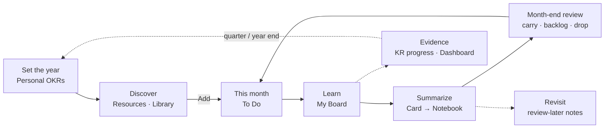

---

## 2. Information architecture

### Sitemap

<!-- mermaid: sitemap -->
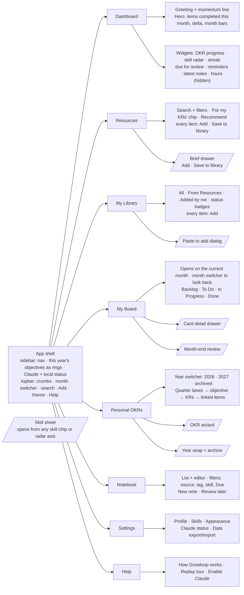

Overlays (`/.../` above) are drawers or dialogs, not pages. Onboarding and the guided tour sit on top of the shell.

### What lives on each screen (key elements only)

| Screen | Key elements | Primary action |
|---|---|---|
| **App shell** | Nav (6 + Settings, Help). Sidebar "2027 objectives": 3–4 rings, current quarter's objective emphasised; before OKRs exist the slot is a "Set your year" link. Footer: "Saved on this device" + Claude status dot. Topbar **Add** opens Paste to add from anywhere. | Navigate |
| **Dashboard** | Serif time-of-day greeting; one momentum line ("You've finished 7 things this month, 3 more than September."). Hero (locked, cannot hide): items completed + delta + month bar chart. Widgets below. Month switcher in topbar. | Open board |
| **Resources** | Catalog grid; filters skill, type, level, cost, length, search; quick chip **For my KRs**; badges *In library*, *On board*, *Fits KR 1.2*. Each item: **Add** (primary) and Save to library. **Recommend** (Claude) when a skill or KR filter is active. | Add |
| **Brief drawer** | Covers, who it's for, takeaways, length, cost, link. **Add** (primary), Save to library. Becomes "Open card" when the item is already on the board. | Add |
| **My Library** | Everything the user owns: saved catalog items + own items. Filters: source, skill, type, status (not started / on board / done). Each item: **Add**. | Paste to add |
| **My Board** | Always opens on the **current month** ("October 2026"); month switcher looks back only. Progress line ("7 of 14 done"), filters (skill, objective, type), four columns. Review banner when last month is unreviewed. | Drag / Move to… |
| **Card detail** | Brief + link · KR link ("Counts toward KR 1.2", optional) · tasks · notes · summary + Refine · review-later · reminder · time (collapsed). | Write summary |
| **Personal OKRs** | Year switcher. Quarter lanes with objective cards; each KR shows skill chip, type, target, progress, linked items, "Find resources". Header: Plan with Claude / Add objective. Archive banner for finished years. | Plan with Claude |
| **Notebook** | List + reading/editing pane. Sources: free note, card summary, card note. Filters: source, tag, skill, **Due**. | New note |
| **Skill sheet** | Description, linked KRs, items on board/done, related resources ("Browse"), notes with this skill. Replaces the PRD's Skills page (S-3) since Skills has no nav item. | Browse resources |
| **Settings** | Name; skills add/rename/hide; theme; Claude status + setup steps; export/import/reset. | — |
| **Help** | How Growloop works (the loop above, with links into each area); Replay tour; Enable Claude; data & privacy. | Replay tour |

### One verb: Add (and why there is no "Add to backlog")

- **Add** = "I'm doing this, this month." It puts the item straight into **To Do** of the current month and saves it to My Library if it isn't there yet. No dialog.
- After Add, a toast offers the KR link without forcing it: "Added to October · *Link to KR 1.2*" when exactly one KR in the current quarter matches the item's skill, otherwise "Added to October · *Link to a key result*". Undo is in the same toast.
- **Save to library** = "interesting, not now." It is the someday list.
- **Recommendation: drop "Add to backlog" as a button.** With Library as the someday list, a second "later" button forces a choice between two near-identical places. Backlog stays as a **board column**: committed, but not this month. Things arrive there by drag / "Move to Backlog", by "Back to backlog" in the month-end review, and automatically from accepted OKRs whose KRs target a specific material or certification.

---

## 3. Flows

Notation: rounded = entry, diamond = decision, double-bar = sub-flow, dotted = optional.

### a) First run and onboarding

Two short steps, then the tour. **Objectives are asked for, not forced**: skipping is allowed, but the app keeps one calm "Set your year" prompt where objectives would show (dashboard hero, sidebar rings, KR link toast) until they exist. Nothing is locked.

<!-- mermaid: onboarding -->
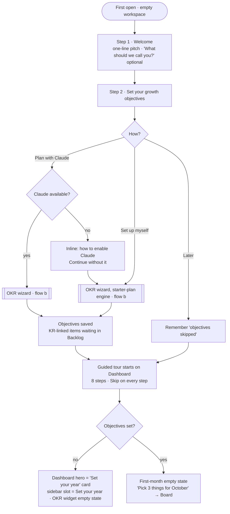

Edge cases
- **Name skipped**: greeting drops the name ("Good afternoon").
- **Closed mid-onboarding**: resume at the same step on next open; the tour starts only after step 2.
- **Hosted demo**: no onboarding; sample workspace; banner "Demo · sample data · Claude runs only locally".
- **Tour** replays from Help; completion/skip remembered locally. Steps: Dashboard, Personal OKRs, Resources, My Library, My Board, Card detail, Notebook, Help.

### b) OKR wizard

**One flow, two drafting engines.** The questions are always asked; Claude drafts when available, otherwise a rules-based **starter plan** drafts from the same answers. Both land on the same review screen. A "Start blank" link on the review screen covers fully manual users. This makes the no-AI path nearly as good as the AI path instead of a bare form.

Entry: onboarding, Personal OKRs empty state, "Plan with Claude", year wrap (flow i).

<!-- mermaid: wizard -->
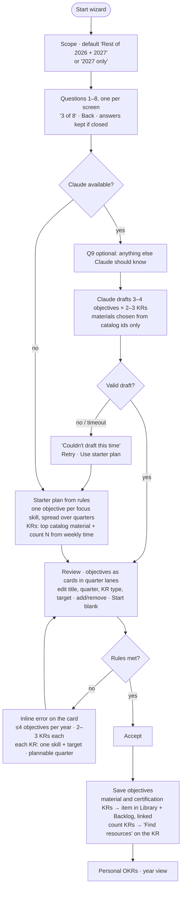

**Fixed question set** (choices, not essays; under 3 minutes)

| # | Question | Input | Used for |
|---|---|---|---|
| 1 | What's your role today? | Aspiring PM · APM · PM · Senior PM · Lead / Group PM | Level of resources |
| 2 | What do you want the next 12 months to get you? | Promotion · Switch into product · Stronger in my current role · Move into leadership · Other (text) | Objective framing, the "why" line |
| 3 | Which skills matter most for that? | Pick 2–4 from your skills | KR coverage |
| 4 | For each: where are you now, where do you want to be? | Two 1–5 scales per skill (Novice → Expert) | Ambition and order (biggest gap first). *Also the self-assessment, see §6.* |
| 5 | How much time can you give learning per week? | < 2 h · 2–4 h · 4–6 h · 6 h + | Size of N in count KRs |
| 6 | Which formats work for you? | Books · Courses · Articles · Podcasts · Certifications | Material choices |
| 7 | Is there a certification you're aiming for? | No · Yes (catalog autocomplete or free text) | Certification KR |
| 8 | Any quarters to keep light? | Multi-select of plannable quarters | Quarter placement |
| 9 | *(Claude only, optional)* Anything else Claude should know? | Free text | Context |

**Output shape** (same for both engines)

```
plan
  scope: "2026-Q4..2027-Q4"
  rationale: one line
  objectives[3..4 per year]
    title         outcome-phrased, ≤ 70 chars ("Lead roadmap conversations with confidence")
    quarter       "2027-Q1"   (one per quarter by default; light quarters skipped)
    why           one line tied to Q2
    keyResults[2..3]
      skillId     exactly one
      type        certification | material | count
      target      { materialId } | { count: N }
      title       generated, editable ("Finish Continuous Discovery Habits", "Complete 4 Stakeholder items")
```

Rules both engines follow: every focus skill gets at least one KR; a certification KR only if Q7 is yes; no two count KRs on the same skill in the same quarter; default N per count KR by weekly time: 2 / 3 / 4 / 5 items.

### c) Discover → plan

Context carries through: "Find resources" on a KR opens Resources filtered to that skill, and **Add** from there links to that KR automatically (shown in the toast, removable).

<!-- mermaid: discover -->
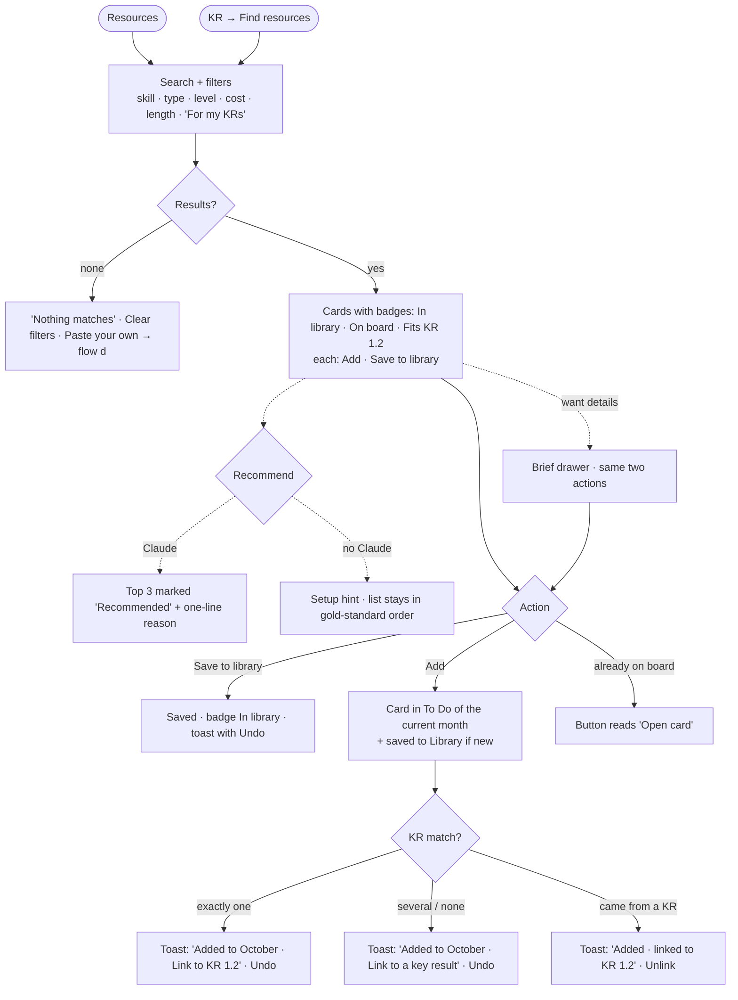

Edge cases: no objectives yet → toast offers "Set your year" instead of a KR link; the KR link can always be set later in card detail; Add on an item that is Done in a past month asks "Do it again this month?" (re-reading is legitimate).

### d) Paste to add (My Library)

<!-- mermaid: paste -->
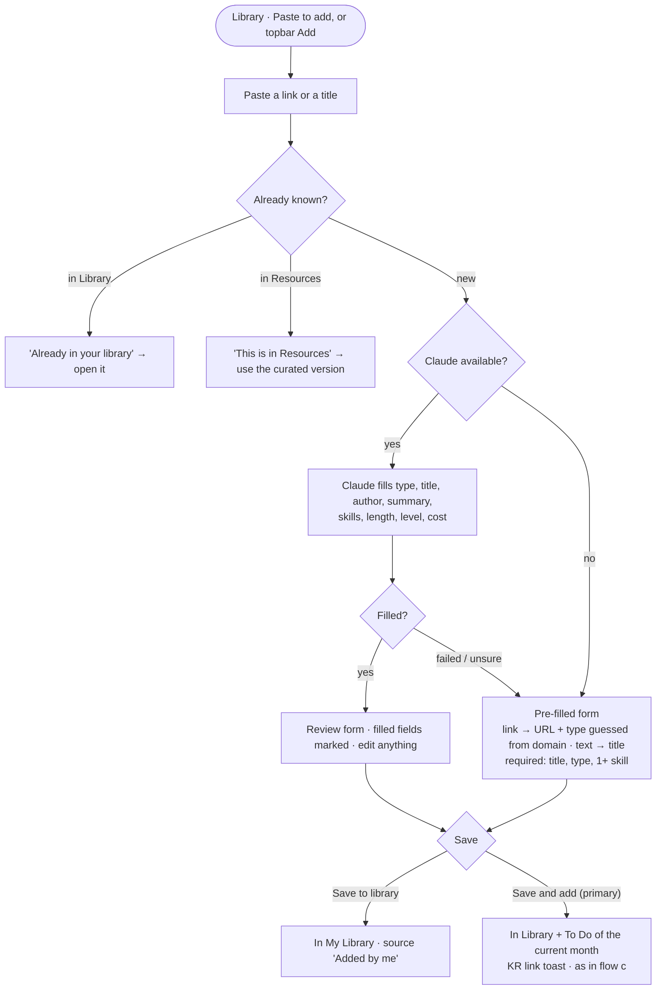

Edge cases: one item per paste (multi-line paste uses the first line, with a note); empty paste disables the buttons; failure never loses the pasted text.

### e) Execute the month → card → summary → Notebook

<!-- mermaid: execute -->
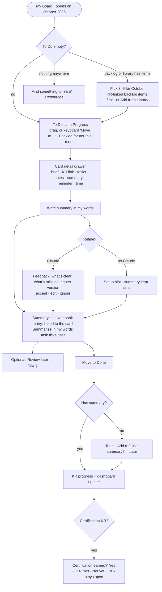

Looking back: the month switcher shows past months' To Do / In Progress / Done as they ended (read-only columns, cards still open for notes and summaries). The Backlog column is shown only on the current month. No future months: planning ahead is what Backlog is for.

### f) Month-end review

Triggered on the first open in a new month. Non-blocking: the new month's board is usable straight away; the banner stays until the review is done. **Defaults do the work**: In Progress defaults to carry over, To Do to back to backlog, so "Confirm all" is one click.

<!-- mermaid: review -->
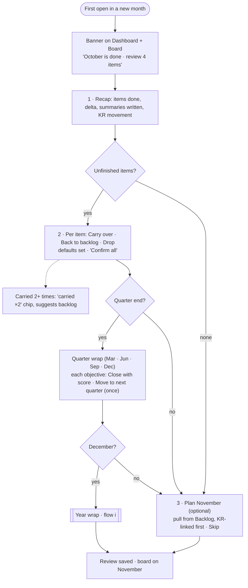

Edge cases
- **Missed several months**: one combined review; carried items land in the current month.
- **Drop** keeps history and the item's notes (Notebook), removes it from the board.
- **Backlog** is never reviewed; it simply rolls forward.

### g) Notebook review-later loop

<!-- mermaid: notebook -->
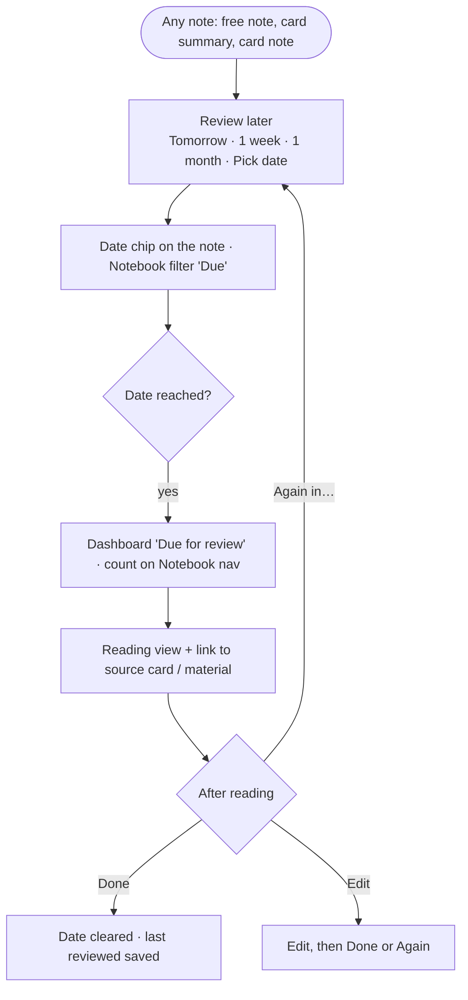

Edge cases: the widget shows the 3 oldest due notes + "n more"; notes from dropped or archived items stay reviewable; empty Notebook explains that summaries land here automatically and offers New note (title, body, tags, optional skill).

### h) Dashboard customize

<!-- mermaid: customize -->
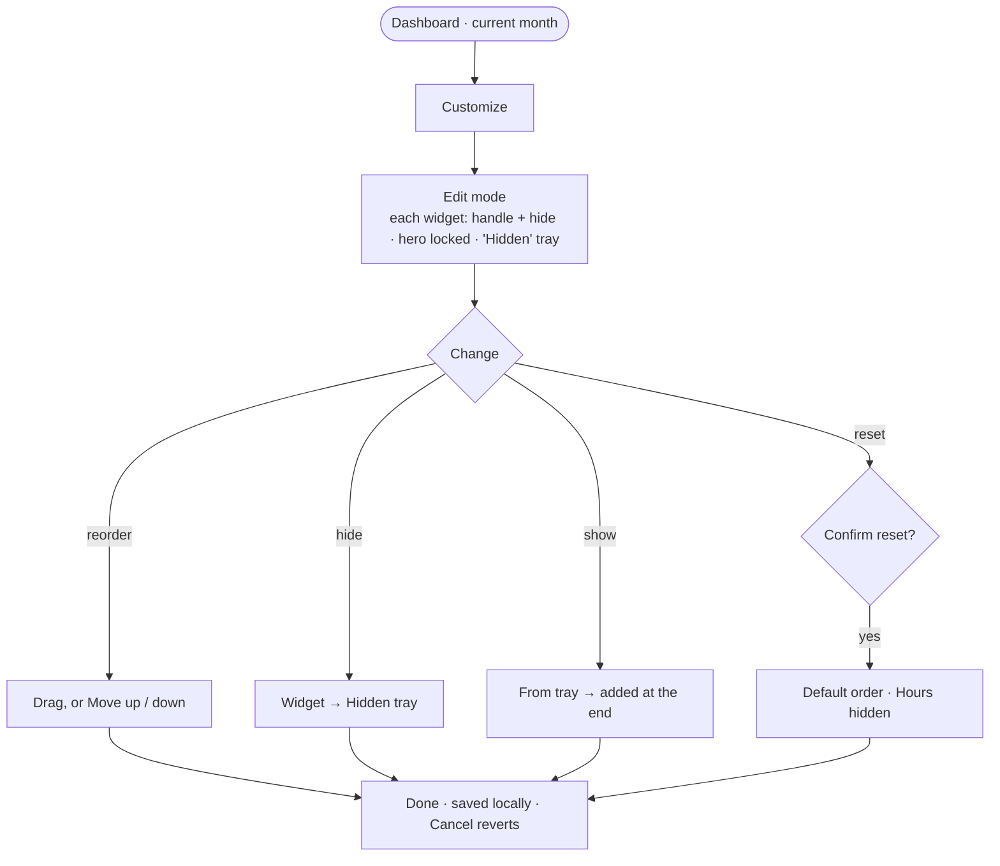

Default order: Hero (locked; items completed this month vs last) · Current-quarter OKRs · Skill radar (this month) · Due for review · Reminders · Streak · Latest notes · *(hidden)* Hours. The month switcher re-scopes hero, radar, streak and hours; the OKR widget follows that month's quarter. Hours shown with no logs: "Log time on a card to see hours here." Everything hidden: hero plus a Customize link.

### i) Year end → archive → next year

<!-- mermaid: year -->
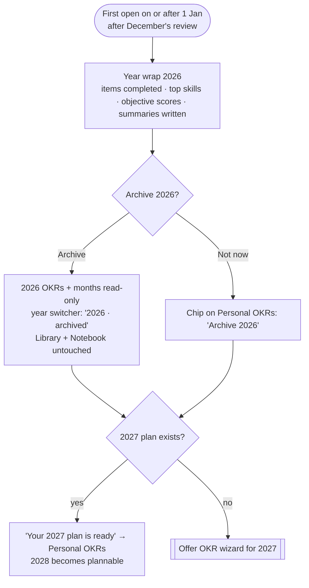

Edge cases
- Archive is only offered once December's review is done (no half-finished months in a frozen year).
- Backlog items linked to 2026 KRs stay in the backlog; the link shows "KR archived" and can be re-pointed.
- Archived cards open read-only; their summaries remain editable in the Notebook (knowledge is not archived).
- No unarchive in MVP.

---

## 4. Cross-cutting rules

### How the objects connect

<!-- mermaid: model -->
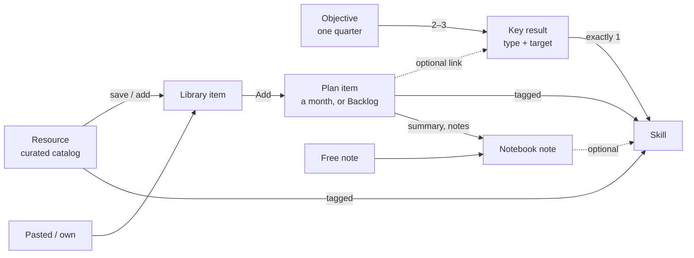

1. **Skill is the join, KR link is the commitment.** Everything is tagged with skills; only plan items carry an explicit KR link, and it is always optional. Resources match KRs through skills ("Fits KR 1.2").
2. **Library ⊇ everything planned.** Add from Resources also saves to Library. A plan item always points at a library item. "Remove from library" is unavailable while the item has an active card.
3. **Resources is read-only.** It ships with the app; the user's copy is the library item.
4. **The month is the only cycle.** Backlog has no month; To Do / In Progress / Done belong to one month. The board always opens on the current month.
5. **One source of truth for writing.** A card's summary and notes *are* Notebook notes (linked by `planItemId`), not copies. Editing in either place edits the same note. A note appears in the Notebook once it has content.
6. **Skills have no page in the nav.** A skill sheet opens from any skill chip or radar axis; management lives in Settings → Skills.
7. **Claude is optional everywhere.** One status (sidebar footer, Settings). Every Claude button has a no-Claude outcome: a hint plus a working fallback, never a dead end. Claude output is always reviewed by the user before saving.

### Where the link is visible

| Place | What the user sees |
|---|---|
| Personal OKRs | Each KR: skill chip, type icon, target, progress, linked cards with status, "Find resources" |
| Resources / Library | "Fits KR 1.2" badge; KR link offered in the toast after Add |
| Board card | "KR 1.2" tag + skill chips; board filter by objective |
| Card detail | "Counts toward KR 1.2 · Finish Continuous Discovery Habits" with Change / Link |
| Dashboard | Current-quarter OKR widget; skill radar axes open skill sheets |
| Sidebar | The year's objectives as rings; current quarter emphasised |
| Skill sheet | Linked KRs, items, related resources, notes |

### KR progress rules

| KR type | Target | Progress | Met when |
|---|---|---|---|
| **Material** | One library item | Linked card's task completion, capped at 99 % until Done | Linked card moves to Done |
| **Certification** | One certification item | 0 → "Preparing" (task %) once the linked card is on a month | Card Done **and** user confirms "Certification earned" |
| **Count** | N items in the KR's skill | Done items tagged with that skill, completed inside the objective's quarter / N. No linking needed; linked items always count. | Count ≥ N |

- Because count KRs count by skill, the optional KR link never costs the user progress; it only matters for material and certification KRs, which the wizard links automatically.
- **Objective progress** = mean of its KRs. Pace label ("On pace", "Behind") compares progress with quarter elapsed, as in the Linen mockup.
- Material/certification KR whose card is dropped: "No active item" + Re-add.
- At quarter close (flow f): an objective is closed with its score, or moved once to the next quarter (keeps its KRs and links).
- Progress is computed, never typed. There is no manual KR in the new model (see open question 2).

---

## 5. Data model deltas for the architect

Against `src/lib/domain/types.ts`. Monthly-only keeps `MonthKey` and most of the board model intact.

1. **Profile & settings**: `name?`, `onboarding { completedAt?, objectivesSkipped? }`, `tourDoneAt?`, `dashboard: { widgetId, visible, order }[]`. No cycle setting.
2. **Month review**: keep `RolloverRecord` (rename to month review if desired); add optional `quarterWrap: { objectiveId, outcome: closed | moved }[]`.
3. **Year**: `{ year, archivedAt? }`; plannable quarters derived from today.
4. **Objective**: add `why?`, `status: active | closed | moved`, `finalProgress?`, `source: wizard | starter | manual`. Derive `skillIds` from KRs instead of storing.
5. **KeyResult**: replace `progressMode` / `manualProgress` with `type: certification | material | count`, `skillId`, `target: { materialId } | { count }`, `metAt?`. Title stays editable.
6. **Material**: add `"certification"` to `MaterialType`. Split **catalog resource** (shipped, read-only) from **LibraryItem** `{ id, materialId | ownMaterial, source: catalog | own, savedAt }`.
7. **PlanItem**: `month: MonthKey | null` (null = backlog); `libraryItemId`; `status` adds `dropped`; `carriedFrom` unchanged; move `notes` / `summary` out to Note.
8. **Note** (new): `{ id, kind: free | summary | item_note, planItemId?, title?, body, tags[], skillId?, reviewAt?, lastReviewedAt?, refinedAt?, createdAt, updatedAt }`.
9. **Activity log**: add `note_reviewed`; keep the rest.
10. **Extension only (if §6 is adopted)**: `SkillLevel { skillId, current 1–5, target 1–5, at }`; `profile.context?` (pasted CV text, local only).

Docs to update: ADR 007 (cycle choice is now superseded: monthly only) and PRD B-5, RS-4, ML-3 (Add to backlog → Add to this month), H-2/H-4 (tour still names the Skills page). ADR 006 says the hours widget appears only when time is logged; the new decision is hidden by default and user-enabled.

---

## 6. Optional extension: skill profile (pending, not confirmed)

> Not part of the confirmed scope. Shown so the owner can decide.

**Insight: the self-assessment is already inside the wizard.** Q4 asks current and target level for each focus skill, which the wizard needs anyway to pick ambition and order. Store those answers and the "skill spider chart" (current vs target) falls out for free, as a toggle on the dashboard radar (*Activity / Level*) rather than a new screen. The "personal box" (paste LinkedIn/CV) is just Q9 with a bigger text box, saved as reusable context for the next wizard run.

Recommended staging: ship Q4 with the wizard (no extra UI), defer the Level chart and CV paste until the owner confirms.

---

## 7. Owner decisions (2026-10-17)

| # | Question | Decision |
|---|---|---|
| 1 | First, partial year | Wizard plans **rest of 2026 + 2027**: at most 1 objective for Q4 2026, 3–4 for 2027. Caps per calendar year. |
| 2 | Applied-practice KRs | Keep three KR types; practice is modelled as the user's own library items counting toward a count KR. |
| 3 | Unfinished objective at quarter end | **Closes with its final score**; can be moved once to the next quarter in the quarter-end review. |
| 4 | "Objectives first" | **Soft gate**: skippable; a single "Set your year" prompt stays until done. Nothing locked. |
| 5 | Skill profile | **Level question in the wizard now**; Level chart and LinkedIn/CV paste deferred. |
