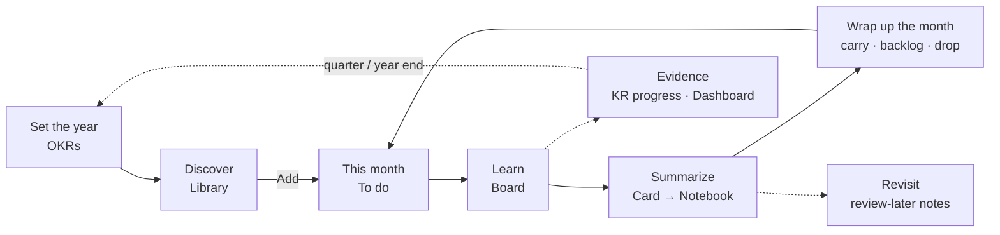
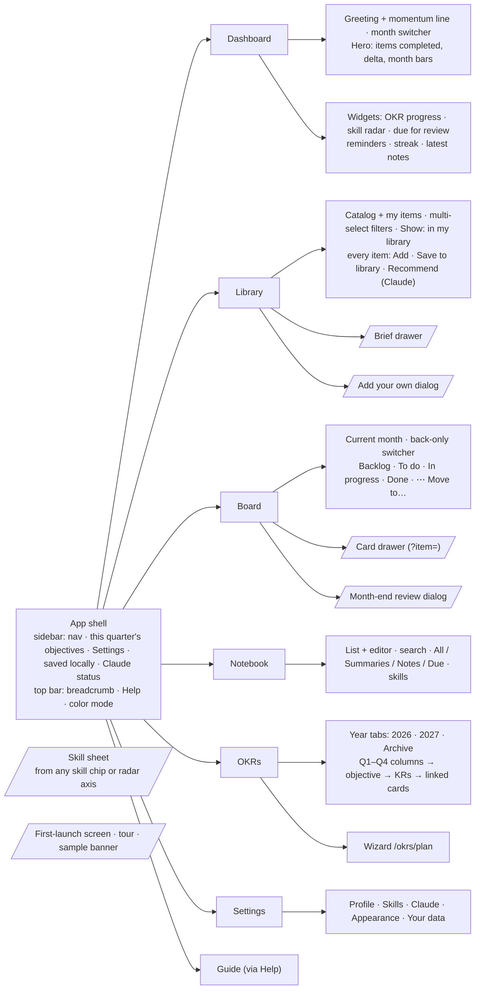
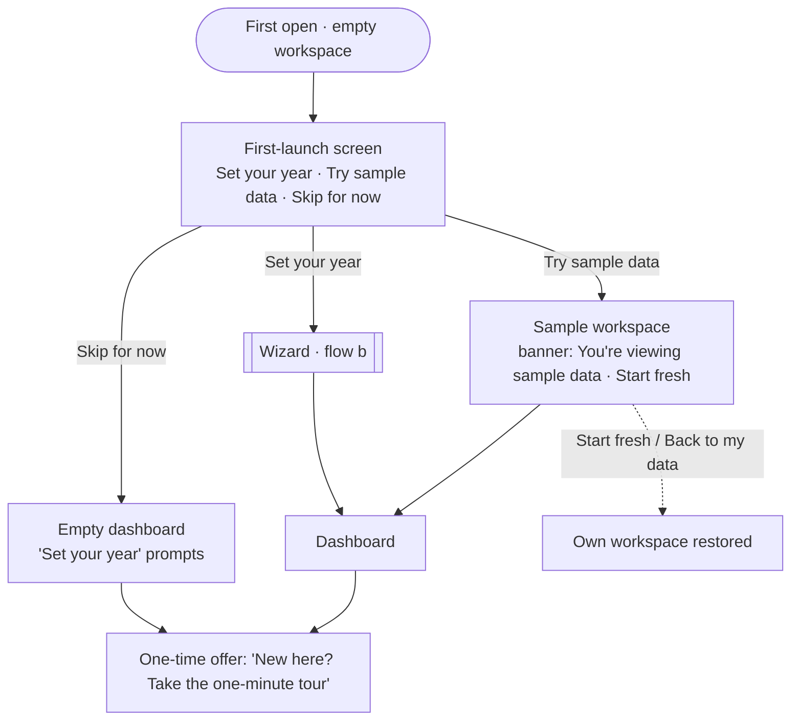
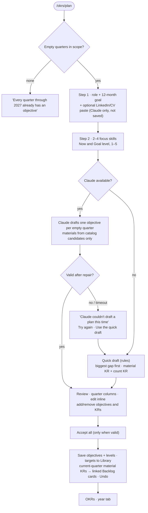
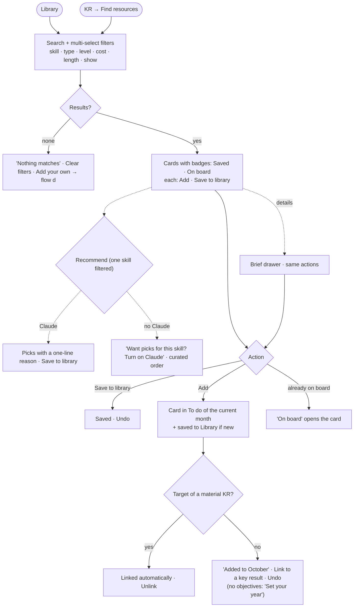
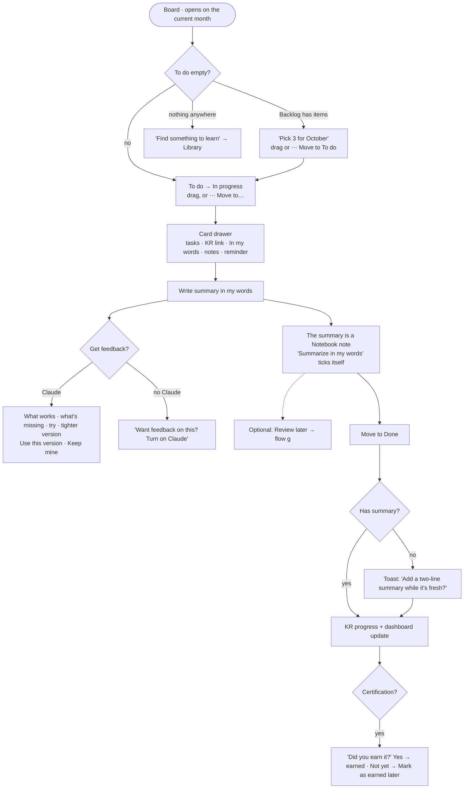
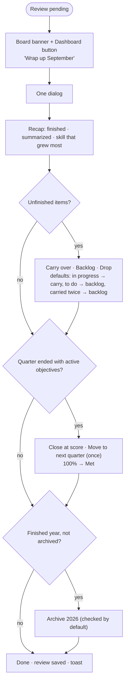
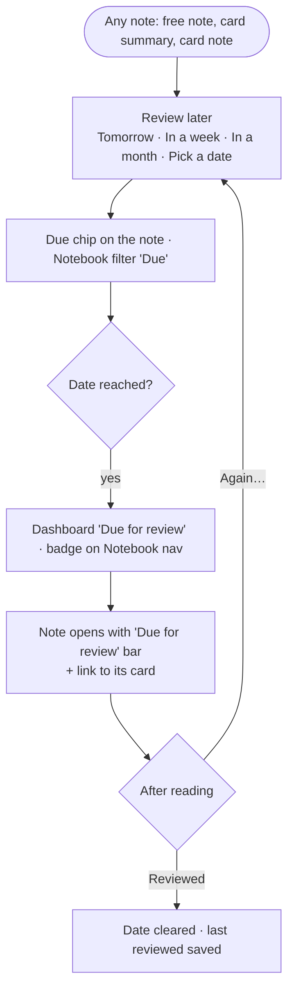
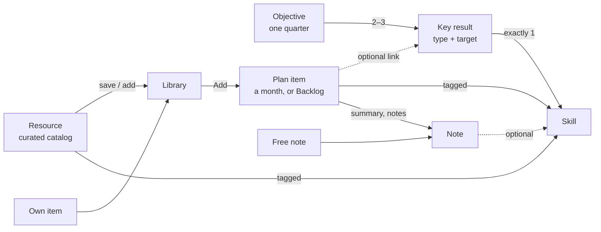

# Growloop: information architecture and user flows

| | |
|---|---|
| **Scope** | IA, end-to-end flows, cross-cutting rules, data model. Not visual UI. |
| **Inputs** | `docs/PRD.md`, ADR 001–011, Linen direction (`design/directions/2-warm.html`), owner decisions (§7) |
| **Detail** | Screen-level behavior, copy and acceptance criteria live in [`docs/product/specs/`](../product/specs/README.md); this doc is the map. |
| **Visual review** | `design/flows/index.html` (to be refreshed in the Linen polish package) |
| **Date** | 2026-10-17 · revised 2026-10-18 |

---

## 1. Jobs to be done

| # | When I… | I want to… | Lives in |
|---|---|---|---|
| J1 | think about my next career step | turn it into a few measurable growth goals for the year | OKRs |
| J2 | have time to learn | know what is worth my time for those goals, and start it | Library |
| J3 | start a month | commit to a realistic amount, not a wish list | Board, month-end review |
| J4 | finish something | make it stick, in my own words, and see it again later | Card detail, Notebook |
| J5 | wonder whether I'm growing | see evidence, not a feeling | Dashboard, KR progress, skill sheet |

**J1 is the anchor, J3–J4 are the habit.** J1 stays a short, mostly once-a-year effort (two questions in the wizard); the month is the rhythm everything else runs on.

### Core loop

<!-- mermaid: loop -->

---

## 2. Information architecture

### Sitemap

<!-- mermaid: sitemap -->

Overlays (`/.../` above) are drawers or dialogs, not pages.

### What lives on each screen (key elements only)

| Screen | Key elements | Primary action |
|---|---|---|
| **App shell** | Nav: Dashboard, Board, Library, Notebook (due badge), OKRs; Settings at the bottom. Sidebar shows this quarter's objectives as rings, or "Set your year". Footer: "Saved on this device" + Claude status. Top bar: breadcrumb, Help, color mode. No global search or Add in MVP. | Navigate |
| **Dashboard** | Date, serif greeting, one momentum line. Hero (locked): items completed + delta + month bars. Widgets. Month switcher (back only). Wrap up button when a review is pending. | Open board |
| **Library** | Resources and My Library on one page: catalog grid, multi-select filters, search, sort, Show (All / Not in my library / In my library), badges *On board*, *Saved*. Each item: **Add**, Save to library. Recommend (Claude) when one skill is filtered. Add your own. | Add |
| **Brief drawer** | Covers, who it's for, takeaways, length, cost, link, skill impact. Add / Save; "On board" opens the card. | Add |
| **Board** | Current month; back-only switcher; progress line ("7 of 14 done"); skill and objective filters; four columns; ⋯ menu on each card. Wrap-up banner when a review is pending. | Drag / Move to… |
| **Card drawer** | Header + status · skills · KR link · tasks · In my words + Get feedback + Review later · notes · reminder · About (collapsed) · Time (collapsed). | Write summary |
| **OKRs** | Year tabs; quarter columns; objective cards with KRs, progress, pace, linked cards; contextual Plan my year / Fill empty quarters. | Plan my year |
| **Wizard** | Step 1 role + goal (+ optional CV paste with Claude); step 2 skills + levels; draft; inline review; Accept all. | Accept all |
| **Notebook** | List + editor; search; source chips; skills filter; Due. New note. | New note |
| **Skill sheet** | Description, level (Now/Goal), this year's KRs, cards on the board, notes, Browse resources. Replaces the Skills page. | Browse resources |
| **Settings** | Name; skills add/rename/recolor/hide; Claude key + status; light/dark/system; export/import/sample/erase. | — |
| **Guide** | How Growloop works: the loop and each area in a few sentences; Take the tour. | Take the tour |

### One verb: Add (and why there is no "Add to backlog")

- **Add** = "I'm doing this, this month." It puts the item straight into **To do** of the current month and saves it to My Library if it isn't there yet. No dialog.
- After Add, the item offers the KR link in place without forcing it, plus Undo. If the item is a KR's target material, it links itself.
- **Save to library** = "interesting, not now." It is the someday list.
- **Backlog** stays as a **board column**: committed, but not this month. Things arrive there by drag or ⋯ Move to, by "Backlog" in the month-end review, and from accepted wizard plans (current-quarter material KRs).

---

## 3. Flows

Notation: rounded = entry, diamond = decision, double-bar = sub-flow, dotted = optional.

### a) First run

One light screen, no questions. **Objectives are asked for, not forced**: skipping is allowed, and one calm "Set your year" prompt stays where objectives would show until they exist. Nothing is locked. Spec: [onboarding.md](../product/specs/onboarding.md), [sample-data.md](../product/specs/sample-data.md).

<!-- mermaid: onboarding -->

Edge cases
- **No name prompt**: greeting is "Good afternoon"; a name can be set in Settings.
- **Existing data**: the screen never shows.
- **Hosted vs local**: identical; only Claude Code availability differs.
- **Tour**: offered, never auto-started; always in Help.

### b) OKR wizard

**One flow, two drafting engines.** The two question steps always run; Claude drafts when available, otherwise the rules-based **quick draft** drafts from the same answers. Both land on the same review screen. Spec with exact copy, rules and schema: [okrs-and-wizard.md](../product/specs/okrs-and-wizard.md).

Entry: first-launch screen, sidebar, OKR widget, OKR page (all link to `/okrs/plan`).

<!-- mermaid: wizard -->

**Question set**

| # | Question | Input | Used for |
|---|---|---|---|
| 1 | Your role | Aspiring PM · Associate PM · Product Manager · Senior PM · Lead or Group PM | Tone, framing |
| 2 | What should the next 12 months get you? | A promotion · A move into product · Stronger in my current role · A step into leadership · Something else (text) | The "why" line |
| 3 | Pick 2 to 4 skills | Visible skills | KR coverage, quarter order |
| 4 | Now and Goal per skill | Two 1–5 scales (New to it → Expert) | Order (biggest gap first), material level, count size; saved as skill levels |
| — | *(Claude only, optional)* LinkedIn or CV | Free text, used once | Context |

Dropped: weekly time, formats, target certification, light quarters (sized or chosen in review instead).

### c) Discover → plan

Context carries through: "Find resources" on a count KR opens the Library filtered to that skill; adding a material KR's target links it automatically.

<!-- mermaid: discover -->

### d) Add your own (Library)

Built as specified: paste a title or link; duplicates point to the existing item; Claude fills the details for review, or a pre-filled form without Claude; Save to library or Save and add. One item per paste; failure never loses the pasted text.

### e) Execute the month → card → summary → Notebook

<!-- mermaid: execute -->

Looking back: the month switcher shows past months read-only (no Backlog column); cards still open, and their notes stay editable. No future months: planning ahead is what Backlog is for.

### f) Month-end review

Due when a decision is needed: unfinished items from past months, active objectives in ended quarters, or a finished year to archive. Non-blocking: a Board banner and a Dashboard button stay until done. **Defaults do the work**, so Done is one click. Spec: [board.md](../product/specs/board.md#month-end-review).

<!-- mermaid: review -->

Edge cases
- **Missed several months**: one combined review; each ended quarter gets its own close block.
- **Drop** removes the card; its notes and activity stay.
- **Backlog** is never reviewed; it rolls forward.
- The separate "Plan next month" step was cut; the board's empty To do state covers it.

### g) Notebook review-later loop

<!-- mermaid: notebook -->

Edge cases: the widget shows the 3 oldest due notes + "n more"; notes from removed, dropped or archived cards stay reviewable and editable.

### h) Dashboard customize

Built. Default order: Items completed (locked: can be moved and resized, not removed) · OKR progress · Skill radar · Due for review · Upcoming reminders · Learning streak · Notes & summaries. Hours are never on the dashboard (ADR 006). The month switcher re-scopes hero, radar and streak; the OKR widget follows that month's quarter.

### i) Year end → archive

Handled inside the month-end review (flow f): once a past year has no active objectives left, the review offers **Archive 2026** (checked by default). Archived years move under the OKRs **Archive** tab, read-only. If declined, the year tab shows an "Archive 2026" button. Library and Notebook are never archived. No unarchive in MVP.

---

## 4. Cross-cutting rules

### How the objects connect

<!-- mermaid: model -->

1. **Skill is the join, KR link is the commitment.** Everything is tagged with skills; only plan items carry an explicit KR link, and it is optional (material KRs link themselves).
2. **Library ⊇ everything planned.** Add from Resources also saves to the library.
3. **Resources are read-only.** They ship with the app.
4. **The month is the only cycle.** Backlog is a rolling pool; To do / In progress / Done belong to one month. The board always opens on the current month.
5. **One source of truth for writing.** A card's summary and notes *are* Notebook notes (ADR 010).
6. **Skills have no page.** The skill sheet opens from any chip or radar axis; management lives in Settings → Skills.
7. **Claude is optional everywhere.** One status (sidebar footer, Settings). Every Claude action has a working path without it, and Claude output is reviewed before saving.

### Where the KR link is visible

| Place | What the user sees |
|---|---|
| OKRs | Each KR: skill chip, type icon, target, progress, linked cards, Add / Find resources |
| Library | KR link offered after Add; auto-link for KR targets |
| Board card | "KR" tag + skill impact; board filter by objective |
| Card drawer | "Counts toward …" with Change / Unlink, plus "Also counts toward" (count KRs) |
| Dashboard | Current-quarter OKR widget; radar axes open skill sheets |
| Sidebar | This quarter's objectives as rings |
| Skill sheet | This year's KRs on the skill |

### KR progress rules

See [okrs-and-wizard.md §Progress](../product/specs/okrs-and-wizard.md#progress-computed-never-typed). Summary: material = linked card's task % (99% cap until Done); certification = same, met only when earned; count = done items tagged with the skill in the objective's quarter ÷ N. Objective progress = mean of KRs. Pace compares progress with quarter elapsed. Progress is never typed.

---

## 5. Data model (schema v4)

The target model for the foundation package (see [build plan](../product/build-plan.md#wp0-foundation)), against `src/lib/domain/types.ts`:

1. **Profile** (new, in the workspace): `name?`, `role?`, `goal?`, `goalText?`, `skillLevels: { skillId, current 1–5, target 1–5, updatedAt }[]`.
2. **Objective**: add `why?`, `status: active | closed`, `finalProgress?`, `closedAt?`, `movedFrom?`, `source: claude | quick | manual`. Drop stored `skillIds` (derived from KRs). Drop `description` (migrated into `why`).
3. **KeyResult**: replace `progressMode` / `manualProgress` with `skillId`, `type: material | certification | count`, `materialId?`, `count?`. Title stays editable.
4. **PlanItem**: drop `notes`, `notesUpdatedAt`, `summary`, `summaryUpdatedAt` (moved to Note); add `earnedAt?` (certifications) and `summaryNudgedAt?`. `month` and the rolling Backlog are unchanged.
5. **Note** (new): `{ id, kind: summary | item_note | free, planItemId?, materialId?, title?, body, skillIds[], reviewAt?, lastReviewedAt?, refinedAt?, createdAt, updatedAt }`.
6. **Workspace**: add `profile`, `notes`, `archivedYears: number[]`. `RolloverRecord` stays as the month-review record.
7. **Skill data**: built-in skills gain `objectivePhrases: [A, B]` (static data, not stored).
8. **Outside the workspace** (ADR 009): device preferences (`welcomeDoneAt`, `tourSeenAt`, `tourCompletedAt`, `sampleMode`) and the Claude key.

**Migration v3 → v4:** summaries/notes → Note records (with `planItemId`, `materialId`, timestamps); each old KR → count KR on the objective's first skill (or the first visible skill), `count` = max(1, linked items), title kept; `description` → `why`; all objectives `active`, `source: manual`; `profile = { skillLevels: [] }`; `notes = []` plus migrated; `archivedYears = []`.

---

## 6. Skill profile (decided)

The level question ships in the wizard (step 2) and is saved as `profile.skillLevels`; the skill sheet shows and edits it. The level chart is deferred (it will read the same data). The LinkedIn/CV paste ships as an optional wizard box, used once when Claude is available and never saved.

---

## 7. Owner decisions

**2026-10-17**

| # | Question | Decision |
|---|---|---|
| 1 | First, partial year | Wizard plans **rest of 2026 + 2027**, one objective per quarter. Caps per calendar year. |
| 2 | Applied-practice KRs | Keep three KR types; practice is modelled as the user's own library items counting toward a count KR. |
| 3 | Unfinished objective at quarter end | **Closes with its final score**; can be moved once to the next quarter in the month-end review. |
| 4 | "Objectives first" | **Soft gate**: skippable; a single "Set your year" prompt stays until done. Nothing locked. |
| 5 | Skill profile | **Level question in the wizard now**; level chart later. |

**2026-10-18**

| # | Question | Decision |
|---|---|---|
| 6 | Onboarding | **No welcome questions.** One light screen: Set your year · Try sample data · Skip. No name prompt (optional name in Settings). |
| 7 | Sample data | Separate sample workspace with an **"Exit sample" banner** ("You're viewing sample data · Start fresh"); own data kept and restored. |
| 8 | Wizard questions | **Role & 12-month goal**, and **focus skills + current/target level (1–5)**. Optional LinkedIn/CV paste when Claude is available. |
| 9 | Wizard review | **Edit inline, accept all.** |
| 10 | OKR page | **Year tabs (2026, 2027, Archive) with 4 quarter columns.** |
| 11 | Online | Hosted on Vercel; AI uses the visitor's **own Claude API key**; order own key → local Claude Code → off. First visit = empty workspace + Try sample data. |

Product-lead decisions on the questions left open (notebook, card detail, month-end review, settings, help, skill sheet, Move to, empty states, nav) are recorded in the specs and summarized at the top of the [build plan](../product/build-plan.md).
